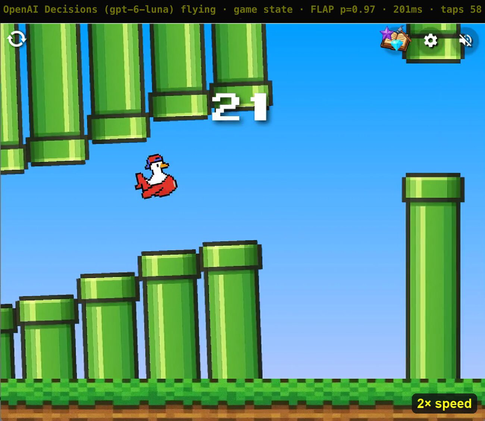
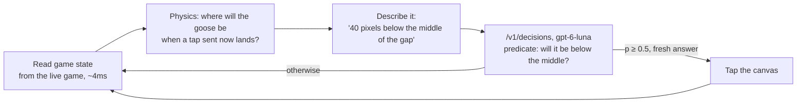

# honk-game-openai-decision-api

[](LICENSE)


I connected OpenAI's [Decisions API](https://developers.openai.com/api/docs/guides/decisions) to my browser, reverse-engineered the internals of [Honk](https://www.reddit.com/r/honk/) (a Flappy Bird-style game that runs inside Reddit), and tuned the setup until the model could play it with real-time decisions. On the test level it finishes **20 out of 20 runs**, at about **110-150ms per decision**, and in endless mode it has flown through **23 pipes** on camera.

[](https://x.com/ventzpetkov/status/2109380287415345487)

*The 23-pipe run, at 2x speed. Click the image to watch the video on X.*

## Table of Contents

- [Overview](#overview)
- [Quick Install](#quick-install)
- [Usage](#usage)
- [The Geeky Bits](#the-geeky-bits)
- [Results](#results)
- [Limitations](#limitations)
- [Documentation](#documentation)
- [Fair Play](#fair-play)
- [Contributing](#contributing)
- [License](#license)

## Overview

This is a fun project, and a deliberately unfair test. The Decisions API (public beta, `gpt-6-luna`) is built for classification: routing tickets, flagging content, scoring things. It returns typed answers (a probability, a choice, a score) instead of text, and OpenAI pitches it as about 10x faster than the Responses API.

A reflex game pushes that to the limit. The goose falls under gravity on every frame, a gap is only a few goose-heights tall, and an answer that arrives 300ms late is already wrong. So the question was simple: is a hosted model fast *and* reliable enough to fly a goose through pipes?

It is, but only after three discoveries:

- **Ask a fact, not an action.** Worded as an action ("flap if below, don't if above"), the model's answers came back *inverted*. Asked as a fact ("will the goose be below the middle of the gap?"), it was right every time.
- **Predict the future.** By the time an answer comes back, the goose has moved. The bot asks about where the goose *will be* when the tap lands, not where it is now.
- **Never wait on one slow answer.** Several questions are always in flight, and late answers are thrown away.

## Quick Install

Requires Python 3.13+, [uv](https://docs.astral.sh/uv/), Google Chrome, and an `OPENAI_API_KEY` with Decisions API access.

```bash
git clone https://github.com/ventz/honk-game-openai-decision-api
cd honk-game-openai-decision-api
uv sync
open -na "Google Chrome" --args --remote-debugging-port=9222 --user-data-dir="$HOME/.cache/honk-chrome"
```

The last line opens a separate Chrome window with its own profile, which the bot attaches to. Chrome doesn't allow remote debugging on your everyday profile, so your normal browser is never touched. On Linux, run `google-chrome` with the same flags.

## Usage

1. In the debug Chrome window, log in to Reddit. In our testing the level stuck at 90% loading while logged out, and Reddit may show a reCAPTCHA first.
2. Open [the easiest level you'll ever play](https://www.reddit.com/r/honk/comments/1tnt19h/the_easiest_level_youll_ever_play/) and press **PLAY** so the game opens in its pop-out window.
3. Run the bot:

```bash
export OPENAI_API_KEY=sk-...

uv run honk_bot.py state                           # one run, prints every decision
uv run honk_bot.py state --runs 20                 # success rate over 20 runs
uv run honk_bot.py state --runs 3 --record videos/demo.mp4
uv run honk_bot.py state --endless --runs 10   # endless mode (open that post first)
uv run honk_bot.py vision --runs 10                # screenshots instead of game state
uv run honk_bot.py capture --seconds 5             # save frames to ./frames, no input
```

For [endless mode](https://www.reddit.com/r/honk/comments/1o7wahu/endless_mode/), open that post instead and add `--endless`, which turns on the best endless setup so far. Experiment flags: `--lat-slots`, `--no-schedule`, `--abandon`, `--plan`, `--lean`, `--pass-px`, `--aim`, `--tick` and `--in-flight` (see `--help` and [docs/findings.md](docs/findings.md#7-endless-mode-in-progress)).

While it plays, a banner across the top of the page shows that OpenAI Decisions is flying the goose, along with each decision, its probability and its latency. A failed run saves a per-tick trace to `logs/`. `--record` saves an MP4 of the tab using Chrome's screencast and `ffmpeg`, with no OS screen-recording permission needed. To use a different Chrome address than `http://127.0.0.1:9222`, set `HONK_CDP_URL`.

The synthetic benchmarks in `benchmarks/` need only the API key: `uv run benchmarks/synthetic_flappy.py`.

## The Geeky Bits



**Getting inside the game.** Honk is a [Devvit](https://developers.reddit.com/) app: a web app Reddit hosts in an iframe on `*.webview.devvit.net`. The bot attaches to Chrome over the DevTools protocol (Playwright's `connect_over_cdp`) and finds that iframe. One snag: frames of a page that was already open report blank URLs over CDP, so the bot asks each frame for its own `location.host`. Inside, the game turned out to be a PixiJS canvas that exposes its whole state as `window.gameInstance`: the goose's hitbox, velocity and death flag, plus the level's obstacles, gravity, scroll speed and finish line. Reading all of that takes about 4ms, against ~40-80ms for a screenshot.

**Finding the gap.** Custom levels are built from arbitrary objects, not just pipe pairs, so the bot gathers every dangerous object within 260px ahead and computes the open vertical bands between them. It aims for the middle of the band nearest the goose.

**Predicting ahead.** A decision takes about 110-150ms, 7-9 frames at 60fps. During that time the goose keeps falling, so the bot runs the game's own physics forward, frame by frame. Measured from the live game, physics runs at a fixed 60Hz in game units, drawn at `scale` (~1.59) screen pixels per unit:

```
each frame:  y += scale·v;   v = min(10, 0.98·(v + 0.4))     (a flap sets v = -6.3)
```

That model predicted a 23-frame fall to within 0.1px; the textbook `y + v·t + ½·g·t²` it replaced was 59px short. The model is asked about the predicted position, not the current one. Without the prediction, its answers described the past.

**The question is the program.** The model is asked one factual predicate, "Will the goose be below the middle of the gap?", given a single sentence such as "The goose will be 40 pixels below the middle of the gap." The code taps when the probability is at least 0.5. Getting here took several attempts:

| Wording | Outcome |
|---|---|
| Raw screen coordinates and velocities | wrong in both directions |
| Natural units (height, climb rate), safe band, predicted height | still wrong |
| "Flap if it will be below the middle; do not flap if above" | **inverted**: p=0.99 to flap at "40 pixels above" |
| "Will the goose be below the middle of the gap?" | p=1.00 / 0.00, correct every time |

**Racing the latency.** A new question goes out every 25ms, with up to 8 fresh ones in flight (the first 20/20 used 50ms and 3; endless mode needed the faster pace). Only the newest answer acts. Three rules throw answers away:

- Older than an answer already acted on.
- Based on a frame read within 60ms after a tap, before the tap had registered. Acting on those caused double flaps into the top pipe. (The tap is marked as sent *before* the click goes out: marking it after let an answer slip through while the click was in transit, and doubled ~12% of taps.)
- Took longer than 250ms. A request that slow also stops counting toward the in-flight limit, so a burst of slow responses can't stop new questions going out. This fix took the bot from 12/13 to 20/20.

The first call on a cold HTTPS connection took ~750ms, long enough to die, so the bot sends a warm-up request before the first tap.

**A bug that made the screen flash.** Screenshots captured at reduced scale inside Chrome (a CDP `clip` with `scale` ≠ 1, or Playwright's `scale="css"`) made the page visibly flash on every capture. A labeled, phase-by-phase test isolated it. The fix is to capture at scale 1 and shrink the image in Python.

## Results

Measured on 2026-10-08 on the easy level, and rechecked at 20/20 (149ms median) on 2026-10-09 with the current code:

| Setup | Completed | Median decision |
|---|---|---|
| Game state + factual question + tap settle + stall handling | **20/20** | 110ms |
| Same, without stall handling | 12/13 | 105-115ms |
| Same, without the tap settle | 7/10 | 125ms |
| Earlier wordings (raw numbers, action rules) | 0/7 | ~120ms |
| Screenshots (360px) + factual `above`/`below` choice | 0/10 | ~280ms |

From screenshots, the model couldn't judge fine vertical alignment. It answered "above" on every frame and never flapped.

Endless mode, on 2026-10-09 (score = pipes passed; the last three rows at ~140ms per decision):

| Setup | Scores | Mean | Best |
|---|---|---|---|
| Before the physics and tap fixes (earlier batches, ~110-150ms) | | ~3 | 19 |
| Several moments per question, act on the one matching the answer's arrival | 0, 6, 4, 7, 9, 5, 0, 14 | 5.6 | 14 |
| Same, plus a scheduled flap for a later moment | 2, 5, 12, 4, 19, 2, 8, 1 | 6.6 | 19 |
| `--endless` (the setup above), 10 runs on camera | 10, 4, 8, 4, **23**, 2, 2, 14, 4, 2 | 7.3 | **23** |

The full write-up is in [docs/findings.md](docs/findings.md).

## Limitations

- **Endless mode is the real test, and it's in progress.** [Endless mode](https://www.reddit.com/r/honk/comments/1o7wahu/endless_mode/) has tighter gaps (~115px of room against ~180px), ramping speed, and later single, moving pipes. The best run so far passed 23 pipes, and runs average about 7, but scores swing widely with the API's latency, which varies hour to hour. Watching a hosted model fly through it is the fun part.
- **Reliably solved on one very easy level only:** [the easiest level you'll ever play](https://www.reddit.com/r/honk/comments/1tnt19h/the_easiest_level_youll_ever_play/), which has one pipe pair, a floor hazard and a short run to the finish. Custom levels with bullets or other moving obstacles haven't been tried.
- **It depends on the game's internals.** `window.gameInstance` is not a public API. A Honk update can break the state reader at any time.
- **Most of the smarts are in the plumbing.** The model makes the call, but the observation, prediction, targeting and timing code is what makes that call possible. That's the honest finding: a classifier this fast is usable in a control loop, but only if you design the loop around it.

## Documentation

- [docs/findings.md](docs/findings.md): what worked, what didn't, and the numbers.
- [Decisions API guide](https://developers.openai.com/api/docs/guides/decisions): OpenAI's official documentation.

## Fair Play

This is an experiment in model latency and reliability, not a way to farm a leaderboard. The bot plays with your logged-in Reddit account, so its completions, attempts and any rewards are recorded as yours. Please don't use it to compete with human players, and check Reddit's and the game's rules before running it.

## Contributing

Issues and pull requests are welcome. Ideas worth trying: harder levels, other question wordings, and whether the vision mode gets better with annotated frames.

## License

[MIT](LICENSE) © Ventz Petkov
