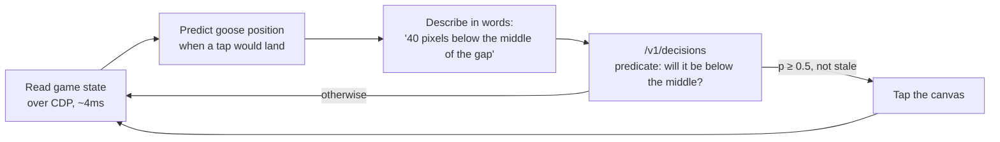

# honk-game-openai-decision-api

[](LICENSE)


Can OpenAI's [Decisions API](https://developers.openai.com/api/docs/guides/decisions) play a reflex game? This bot plays [Honk](https://www.reddit.com/r/honk/), a Flappy Bird-style game that runs inside Reddit, by asking `/v1/decisions` a yes/no question several times a second and flapping on the answer. It completed the test level in 12 of 13 runs (10/10 in one batch), at about 105-115ms per decision.

## Table of Contents

- [Overview](#overview)
- [Quick Install](#quick-install)
- [Features](#features)
- [Usage](#usage)
- [How It Works](#how-it-works)
- [Results](#results)
- [Documentation](#documentation)
- [Fair Play](#fair-play)
- [Contributing](#contributing)
- [License](#license)

## Overview

The [Decisions API](https://developers.openai.com/api/docs/guides/decisions) (public beta, `gpt-6-luna`) returns typed answers (probabilities, a choice, a score) instead of generated text, and OpenAI pitches it as about 10x faster than the Responses API. This project tests that claim on a task where both speed and correctness matter: keeping a goose alive between pipes.

The short version:

- **It's fast enough.** A median of ~105ms per decision, so about 9 decisions a second.
- **The question's wording decides whether it works.** Worded as an action ("flap if below, don't if above"), the answer came back inverted. Asked as a fact ("will the goose be below the middle of the gap?"), it was right every time.
- **Screenshots didn't work.** From game screenshots it couldn't tell whether the goose was above or below the gap. Reading positions from the game and describing them in one sentence did work.

The full write-up is in [docs/findings.md](docs/findings.md).

## Quick Install

Requires Python 3.13+, [uv](https://docs.astral.sh/uv/), Google Chrome, and an `OPENAI_API_KEY` with Decisions API access.

```bash
git clone https://github.com/ventz/honk-game-openai-decision-api
cd honk-game-openai-decision-api
uv sync
open -na "Google Chrome" --args --remote-debugging-port=9222 --user-data-dir="$HOME/.cache/honk-chrome"
```

The last line opens a separate Chrome window with its own profile, which the bot attaches to. Chrome doesn't allow remote debugging on your everyday profile, so your normal browser is never touched. On Linux, run `google-chrome` with the same flags.

## Features

- **Two ways to observe the game.** `state` reads the goose's and the obstacles' positions from the running game. `vision` sends canvas screenshots instead.
- **Typed answers.** Each tick asks a factual predicate or choice and flaps in code on the answer. The model never sees an action rule.
- **Built for latency.** Up to 3 requests in flight, a warm-up request, a prediction of where the goose will be when the tap lands, and a settle window after each tap.
- **On-page banner.** Shows that OpenAI Decisions is driving, with each decision, its probability and its latency.
- **Repeatable runs.** `--runs N` plays N runs back to back, restarts after each death or win, prints a success rate, and saves a per-tick trace for every failed run to `logs/`.
- **MP4 recording.** `--record` records the tab with Chrome's screencast and encodes it with ffmpeg. No OS screen-recording permission is needed.
- **Synthetic benchmarks.** `benchmarks/` measures latency and accuracy on generated frames, with no game needed.

## Usage

1. In the debug Chrome window, log in to Reddit. In our testing the level stuck at 90% loading while logged out, and Reddit may show a reCAPTCHA first.
2. Open a Honk level, such as [the easiest level you'll ever play](https://www.reddit.com/r/honk/comments/1tnt19h/the_easiest_level_youll_ever_play/), and press **PLAY** so the game opens in its pop-out window.
3. Run the bot:

```bash
export OPENAI_API_KEY=sk-...

uv run honk_bot.py state                           # one run, prints every decision
uv run honk_bot.py state --runs 10                 # success rate over 10 runs
uv run honk_bot.py state --runs 3 --record videos/demo.mp4
uv run honk_bot.py vision --runs 10                # screenshots instead of game state
uv run honk_bot.py capture --seconds 5             # save frames to ./frames, no input
```

The default Chrome address is `http://127.0.0.1:9222`; set `HONK_CDP_URL` to change it. Recording needs `ffmpeg` on your `PATH`.

The synthetic benchmarks need only the API key:

```bash
uv run benchmarks/synthetic_flappy.py
uv run benchmarks/synthetic_sidescroller.py
```

## How It Works



- **Observing.** Playwright attaches to Chrome over the DevTools protocol, finds the game's `devvit.net` iframe, and reads the goose's hitbox, velocity and the nearby dangerous objects straight from the running game.
- **Targeting.** From the obstacles ahead it finds the open vertical band closest to the goose and aims for its middle.
- **Deciding.** The model is asked a fact. The code turns the answer into a tap, and drops answers that are older than the newest one used or that come from a frame read before the last tap had registered.

## Results

Measured on 2026-10-08 on one level, 10 runs per setup:

| Setup | Completed | Median decision |
|---|---|---|
| Game state as text + factual question + tap-settle fix | **10/10**, then 2/3 in a later check | 105-115ms |
| Same, without the tap-settle fix | 7/10 | 125ms |
| Screenshots (360px) + factual `above`/`below` choice | 0/10 | ~280ms |

The one failure with the final setup was a latency stall: every in-flight request was slow at once, and no answer arrived for about 350ms while the goose fell. The details, including the inverted-answer test and a screenshot flashing bug, are in [docs/findings.md](docs/findings.md).

## Documentation

- [docs/findings.md](docs/findings.md): what worked, what didn't, and the numbers.
- [Decisions API guide](https://developers.openai.com/api/docs/guides/decisions): OpenAI's official documentation.

## Fair Play

This is an experiment in model latency and reliability, not a way to farm a leaderboard. The bot plays with your logged-in Reddit account, so its completions, attempts and any rewards are recorded as yours. Please don't use it to compete with human players, and check Reddit's and the game's rules before running it.

## Contributing

Issues and pull requests are welcome. Ideas worth trying: a fallback for latency stalls, other levels, other question wordings, and whether the vision mode improves with annotated frames.

## License

[MIT](LICENSE) © Ventz Petkov
